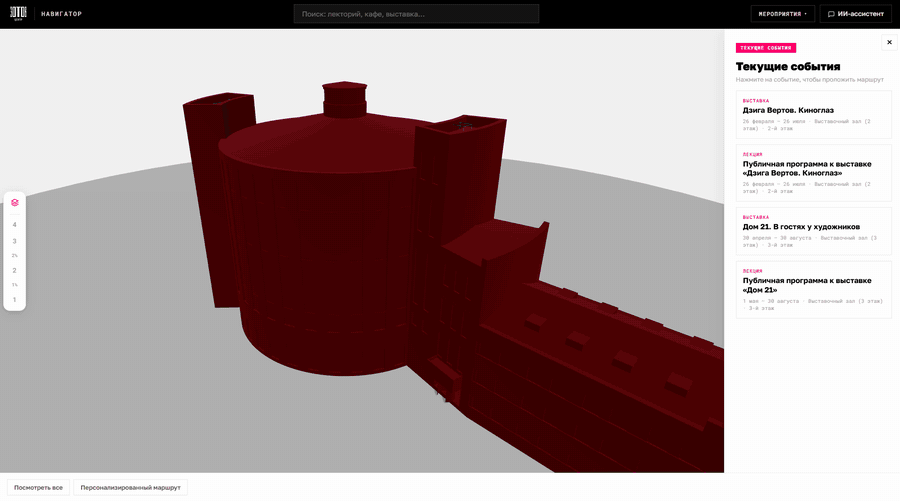
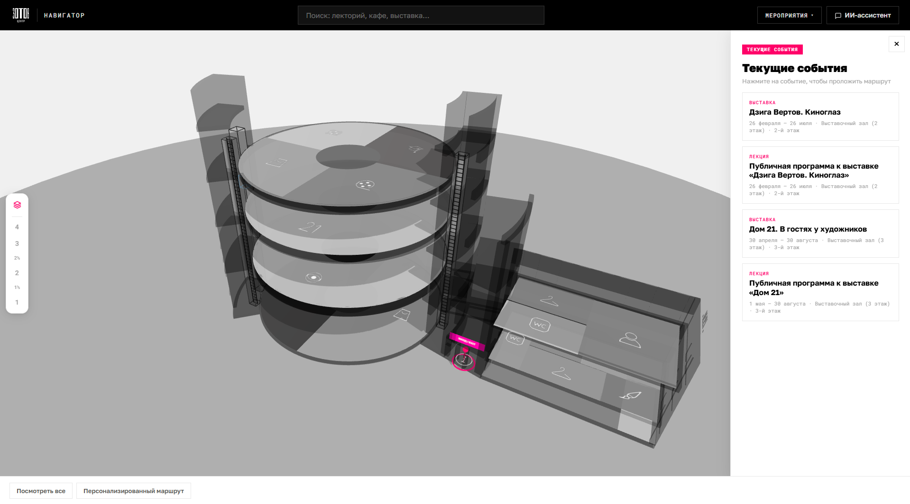
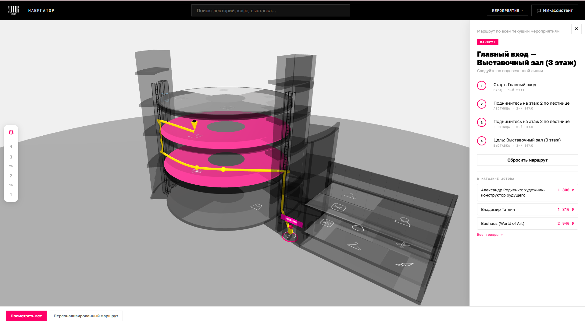
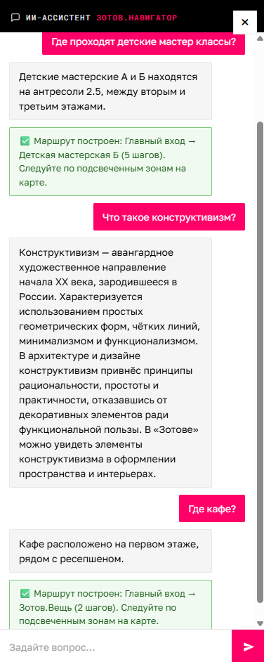

# Зотов.Навигатор

> Веб-приложение с интерактивной **3D-картой** и **ИИ-ассистентом** для навигации по культурному центру «Зотов».

🏆 **3 место** · хакатон «Креаторы и Кодеры» · Universal University × Школа 21



## Проблема

Круглая планировка и кольцевые галереи затрудняют поиск нужного пространства. Задача хакатона — создать прототип навигации по зданию.

## Решение

Посетитель выбирает мероприятие или пространство на карте либо обращается к ИИ-ассистенту. Приложение строит маршрут по 3D-модели здания с четырьмя этажами и двумя антресольными уровнями.

## Скриншоты

| Общий вид | Построенный маршрут | ИИ-ассистент |
|---|---|---|
|  |  |  |

## Возможности

- **Интерактивная 3D-карта** здания на Three.js — вращение, зум, переключение этажей.
- **ИИ-ассистент** — отвечает на вопросы о центре и помогает построить маршрут.
- **Построение маршрута** между зонами с пошаговыми инструкциями.
- **Персонализированный маршрут** через несколько выбранных мероприятий.
- **Глобальный поиск** по зонам и событиям.
- **Афиша** — список ближайших мероприятий с переходом к маршруту.
- **Сценарий «Всё посмотреть»** — обзорный маршрут по ключевым пространствам центра.

## Стек

| Слой | Технологии |
|---|---|
| **Backend** | Java 17, Spring Boot 3.4, Spring Web (REST), Spring Data JPA, Validation |
| **База данных** | H2 (in-memory для демо) |
| **Frontend** | Vanilla JS (ES modules), Three.js для 3D, чистый CSS |
| **Документация API** | springdoc-openapi (Swagger UI) |
| **Интеграции** | jsoup — парсинг афиши с сайта centrezotov.ru |
| **Обмен сообщениями** | Apache Kafka |
| **Сборка** | Maven |

## Архитектура

Классическая слоистая архитектура Spring Boot. DTO отделены от JPA-сущностей, ошибки обрабатываются глобально через `@RestControllerAdvice`.

```
Браузер (Three.js + UI + ИИ-ассистент)
        │  HTTP / JSON
        ▼
Spring Boot Backend
  controller/  REST-контроллеры (/api/...)
  service/     бизнес-логика, построение маршрутов (граф + Dijkstra)
  repository/  Spring Data JPA
  model/       Floor, Zone, Event
        ▼
       H2
```

Граф навигации строится в памяти при запросе: зоны соединены внутри этажа и между этажами через лестницы и лифт. Кратчайший путь ищется алгоритмом **Dijkstra**.

### Микросервисы и Kafka

Отдельный Spring Boot сервис `crawler-service` по расписанию парсит афишу `centrezotov.ru` через jsoup и публикует события в Kafka-топик `zotov.events`. Основной сервис читает их и сохраняет в БД.

Поднять Kafka локально и запустить краулер:

```bash
docker compose up -d                              # Kafka
KAFKA_ENABLED=true ./mvnw spring-boot:run           # основной сервис
./mvnw -f crawler-service/pom.xml spring-boot:run  # краулер, отдельный терминал
```

По умолчанию основной сервис работает без Kafka; слушатель включается через `KAFKA_ENABLED=true`. Подробности — в [`crawler-service/README.md`](crawler-service/README.md).

## REST API

Базовый префикс `/api`, ответы — JSON. Все эндпоинты описаны в Swagger UI после запуска.

| Метод | Путь | Описание |
|---|---|---|
| GET | `/api/floors` | Список этажей |
| GET | `/api/floors/{id}` | Этаж с зонами |
| GET | `/api/zones` | Зоны (фильтры `?type=CAFE&floorId=2`) |
| GET | `/api/events/upcoming` | Ближайшие события |
| POST | `/api/route` | Построить маршрут между двумя зонами |
| POST | `/api/route/multi` | Маршрут по нескольким точкам (план дня) |
| GET | `/api/search?q=...` | Поиск по зонам и событиям |

## Быстрый старт

Требуется JDK 17+.

```bash
git clone https://github.com/yotisha842/ZotovNavigator.git
cd ZotovNavigator
./mvnw spring-boot:run        # Windows: mvnw.cmd spring-boot:run
```

После старта:

- Приложение — http://localhost:8080
- Swagger UI — http://localhost:8080/swagger-ui.html
- H2-консоль — http://localhost:8080/h2-console (JDBC URL: `jdbc:h2:mem:zotov`)

Данные для демо загружаются из `data.sql`. Демоафиша помечена в интерфейсе; её даты рассчитаны относительно дня запуска и не отражают актуальное расписание центра.

Для ИИ-ассистента задайте переменную окружения `GIGACHAT_AUTH_TOKEN` — ключ авторизации GigaChat. Без ключа карта и маршруты работают, чат сообщает, что ассистент не настроен.

## Моя роль

**Кристина Поздеева** — Java backend: доменная модель, REST API, построение маршрутов, интеграция парсинга афиши и отдельный краулер с обменом сообщениями через Kafka.

## Документация

В папке [`docs/`](docs/) — техническая спецификация и исходный кейс от Центра «Зотов».

📄 [Диплом и материалы проекта (Google Drive)](https://drive.google.com/drive/folders/1fT5_ewns_3JcHY44i1cD6fKj_FqIDaQf?usp=sharing)
